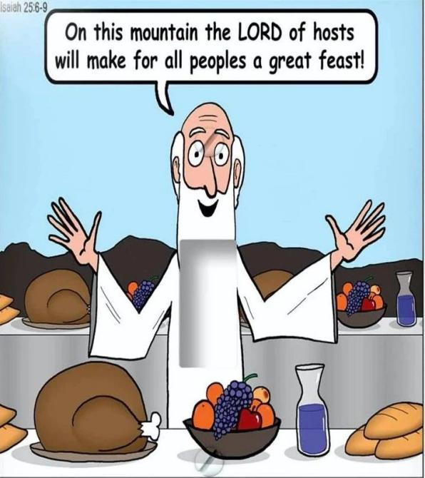
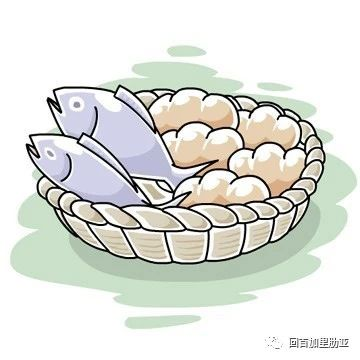
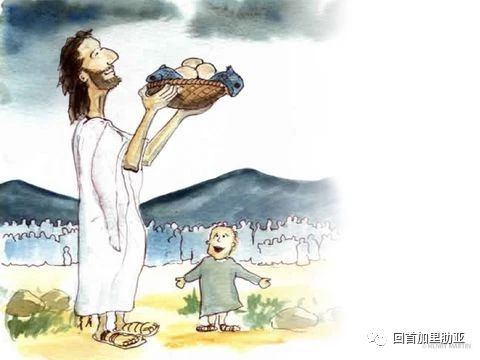
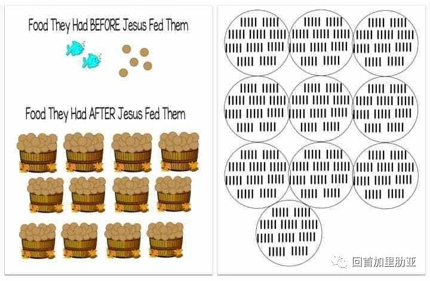
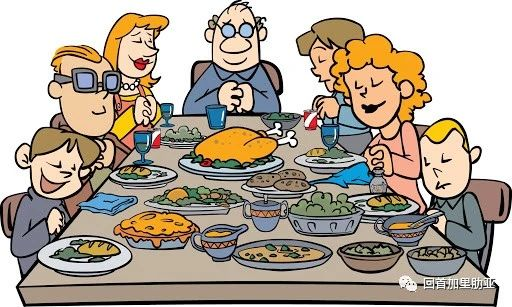

<!--more-->

## 本期开始，我们会编辑每主日的读经内容，发表在副标题推送中

亲爱的孩子们，你们经历过肚子饿的感觉吗？哇，此刻，我仿佛也听到了肚子咕咕叫的声音。人类数千年的文明发展，各个民族、各个国家，有充足的食物以果腹，一直以来都是人们最基本的需求。今天的主日读经，也是从“食物”着手，讲天主对人类的慷慨和满全。读经一里，依撒意亚先知跟我们分享了上主的邀请：肚子饿的，去找他；口渴的，也去找他，我们的心灵会因为饱尝佳肴美味而喜悦。除了吃饱以外，依撒意亚先知更是重述了天主对我们灵性生命的许诺：“你们如果走近我，侧耳听我，你们必将获得生命”。

这句话，和答唱咏中那句，“上主亲近一切呼号他的人，即一切诚心呼号他的人”一样，充满了恩许和肯定。上主，祂一直都在，祂侧耳听我们的呼声，祂俯身满全我们的祈求。到了福音中，跟之前几个星期耶稣用比喻来给群众讲论天国的道理不同，这个主日，耶稣亲自施行了一个奇迹，就是那个家喻户晓、每个人都津津乐道的“五饼二鱼喂饱了五千人”的奇迹——

> 原文此处有一段故事视频，来自 The Holy Tales: Bible 平台。

那时天色已晚，群众甚多，荒野颇偏僻。孩子们，每次想到福音中的这一幕，我都忍不住想笑。对门徒们来说，一定是焦头烂额的时刻：师傅医治病人的时候，手到病除；谈论起天国，滔滔不绝。可！是！讲得再好，手中没有余粮，也没有用啊～～门徒们很慌，想趁民众们还有力气回家之前，就让师傅赶紧打住，遣散他们。没想到的是，从来不走寻常路的师傅，居然跟他们说：“你们，给他们吃的吧。”

还好跟着师傅也不是一天两天了，门徒中的安德肋很快发现了一个小孩带着他仅有的五个饼两条鱼。于是他把这个孩子带到耶稣跟前来。(干得好啊安德肋！这位慷慨捐出自己午餐的小朋友，也很棒！)

耶稣拿过食物，举目望天，感谢了父，掰开，分开门徒。

就这样，小小的奉献，经过耶稣的手，变成了大大的奇迹，满足了所有人。

孩子们，从这个故事的一开始，耶稣就知道民众的需求。福音中说“耶稣知道自己要做什么”。本来想靠岸休息的祂，看到民众那一刻，就心软了，为民众治病，也给他们讲解天国；天色渐晚，身处荒野，耶稣完全洞察到门徒的着急，祂也知道跟随祂的一大群人，有老人，有妇女，有小孩，大家都经不起饿。通过这个增饼的奇迹，耶稣向门徒也向民众表明了，祂可以，祂也愿意，满全人们的需求。

也许你们会问：“耶稣是全能的，祂只要说一句话，食物就会出现了；甚至，祂只要想一想，人们的饥饿就会立即消失了。为什么耶稣不这样做呢？”耶稣让人们感受饥饿，祂也让门徒们体验到自己在解决问题时的无助和能力的限制，然后，祂用了一个小男孩的奉献，来实现祂的奇迹。天主，通过这种方式，让我们明白，唯有祂，可以满全我们最深层次的饥饿和需求。祂也希望我们明白，即使是在我们看来不可能实现的情境之下，祂也可以满全我们(在天主那里，没有不可能)。最重要的是，祂希望这满全，不是祂单向的，祂希望我们，可以通过付出我们的这部分(我们的时间、我们的能力、我们的意愿等等等等)，来参与到祂对我们的满全、对这个世界的满全中。

✦ ✦ ✦

## 给孩子们讲解本周读经

按年龄分组的讨论、游戏与活动建议

### 3–7 岁

从五饼二鱼的奇迹开始，认识天主对我们需求的满全。

**讨论：** 耶稣施行了很多奇迹，你们可以说出你们知道的奇迹吗？这些奇迹说明了什么呢？(耶稣的天主性，耶稣是天主。)耶稣用五饼二鱼喂饱了群众之后，祂让门徒们去做了什么？(把剩下的碎块都收集起来，因为所有的食物都来自天主的恩赐，不可以浪费。)

**艺术手工：** 小小孩们，只知道五千是很大的数字，但是不知道耶稣到底喂饱了多少人。可以参考这张图，给孩子们做一个对照。也可以用纸绘出鱼和面包的形状，来模拟一下耶稣五饼二鱼的奇迹。如果您需要给小小孩的福音主题涂色卡，请后台给我们留言。

**祈祷：** 当我们明白到食物来自上主的恩赐，便更加明白饭前感谢和祈祷的含义。("天主，求你降福我们和我们所享用的食物，我们也为你所赏赐的一切感谢你。愿光荣归于父、及子、及圣神，起初如何，今日亦然，直到永远。阿们。")除了教会传统的祈祷文，孩子们，你们也可以用自己的语言感谢天主赐予的食物，祈求天主让我们吃饱的同时，可以帮助那些还在饥饿中的人们，帮助他们有食物果腹。

### 8–12 岁

从“生命之粮”出发，理解耶稣与玛纳的不同。

**讨论：** 五饼二鱼的增饼奇迹，在四部福音中都有记载。可以邀请孩子们一起去翻看每个福音作者的记载角度。在若望福音中，这个奇迹之后的第二天，同样一群人继续跟着耶稣，耶稣告诉群众，增饼奇迹要传递的最大的信息是：“我是生命之粮。到我这里来的，永远不会饥饿。”你们知道，旧约中天主也曾为饥饿难忍的以色列人，从天降下玛纳。你们知道作为生命之粮的耶稣，跟玛纳有什么不同？(耶稣，亲自化身为食物，来养育我们；耶稣栖身在饼酒之中，藉着大地的出产，人类劳动的果实，一如耶稣的人性和天主性的结合，来给我们留下永生的食粮。)关于耶稣建立的圣体圣血圣事，请参看我们之前写过的今天，庆祝的是「圣体圣血节」

**祈祷：** 孩子们，你和我，我们在多大程度上倚赖天主呢？你知道，天主是我们的食物、水源、藏身之处的最终提供者，甚至此刻你在读这些文字时，你呼吸的空气，也来自天主的恩赐。所以，让我们静默片刻，表达对天主提供这一切供给的感谢。也想一想，生命中还有多少的恩赐，被我们当成了理所当然的存在。让我们为天主满全过的需求，和祂额外的恩赐，逐一感谢天主。也谢谢天主，通过很多的机会，教导我们要仰仗祂，信靠祂，依赖祂。

### 青少年

从“任何受造之物都不能使我们与天主的爱隔绝”出发，探讨信仰与圣事。

**讨论：** 今天的读经二，圣保禄宗徒给罗马人的书，也重述了我们跟天主的关系。“任何受造之物，都不能使我们，与天主的爱隔绝，即与我们的主基督耶稣内的爱隔绝。”这段话有力而美好。如果你们还记得上周的读经一，一定记得撒罗满王向天主求得了智慧。撒罗满也因为他的各项政策和为天主建立的圣殿，享誉至今。然而，很可惜的是，后来，撒罗满王迷失了自我，做了错误的选择，背离了天主。我们跟孩子讨论的时候，他们俩问：“为什么他都求得了智慧，还是会做错事，会离开天主呢？”亲爱的孩子们啊，上主恩赐的礼物，需要我们的善用；如果我们把礼物，放在角落里，弃而不用，时间久了，礼物便会蒙灰，失去了恩宠。如何善用上主的礼物呢？一个很重要的方法，是在祈祷、生活实践和圣事中，去更新礼物，加深我们跟天主的关系。圣事，是耶稣亲自为我们建立的，与天主之间的盟约。有了圣事，我们可以跟天主修和，我们也可以重新拥抱天主。这也是圣保禄说的，任何事物，都不能使我们，与天主的爱隔绝。因为天主的唯一圣子，为了这份爱，付出了自己的生命。祂用生命，换回了我们。

**礼仪：** 今天福音中还有一个细节，不知道你们注意到了吗？耶稣让门徒们叫群众坐下。耶稣把饼掰开，递给门徒之后，再由门徒们递给群众。这个细节，也被圣经学家们认为象征了教会的“圣秩和圣统”，一如我们作为教友，从神父的手中领受圣体。我们都知道，圣洗、坚振和圣体圣事是进入天主子民这个大家庭的入门圣事，圣秩圣事就是确立这个大家庭内各项职务的圣事。藉此圣事，耶稣基督所托付给宗徒的使命，得以在教会中继续执行，直到世代的终结。它包括主教职、司铎职、执事职三个等级。让我们为教会的圣召祈祷，希望更多年轻人，愿意来承担起宗徒的角色，愿意接过耶稣手中的饼，耶稣的司祭职。

---

**资料来源：**
视频来自 The Holy Tales: Bible 平台

原文：Ideale d'Amore · 回首加里肋亚 · 2020-08-01

**原创不易，请订阅我们**

**👉并分享给更多你爱的人们**

*   [儿童主日学](https://urlove.wixsite.com/inme/首頁/categories/儿童主日学)