<!--more-->

## 祂是爱的君王

孩子们，你们每晚祈祷的时候，有没有同爸爸妈妈一起念耶稣亲自教给我们的祈祷文《天主经》呢？我们每次念天主经的时候，都会重复这一句，“愿祢的国来临”。而今天，在教会年历的最后一个主日，我们庆祝基督普世君王节(the Solemnity of Our Lord Jesus Christ, King of the Universe)，庆祝这个天主的国度和全人类都要为之欢欣的耶稣基督的君王身份。

说到君王，我们想到的总是居高位、披华服、无法亲近的帝王，很难把出生在马槽、死在十字架上的耶稣，与王联系在一起。然而耶稣，却是实实在在的，从旧约就已经被预许的犹太人的君王、全人类的君王。祂在约旦河受洗时，就有天主圣父喜悦的声音，说“这是我的爱子”，有天主圣神的形象临在于祂，宣认耶稣是无可指摘的受傅者。而耶稣作为君王，最大的爱，是祂为我们这些子民付出了生命、救赎了我们；祂的复活，是最大的胜利，重新为我们这些本是受造物的人，换取了天国，换取了天主子女的身份。

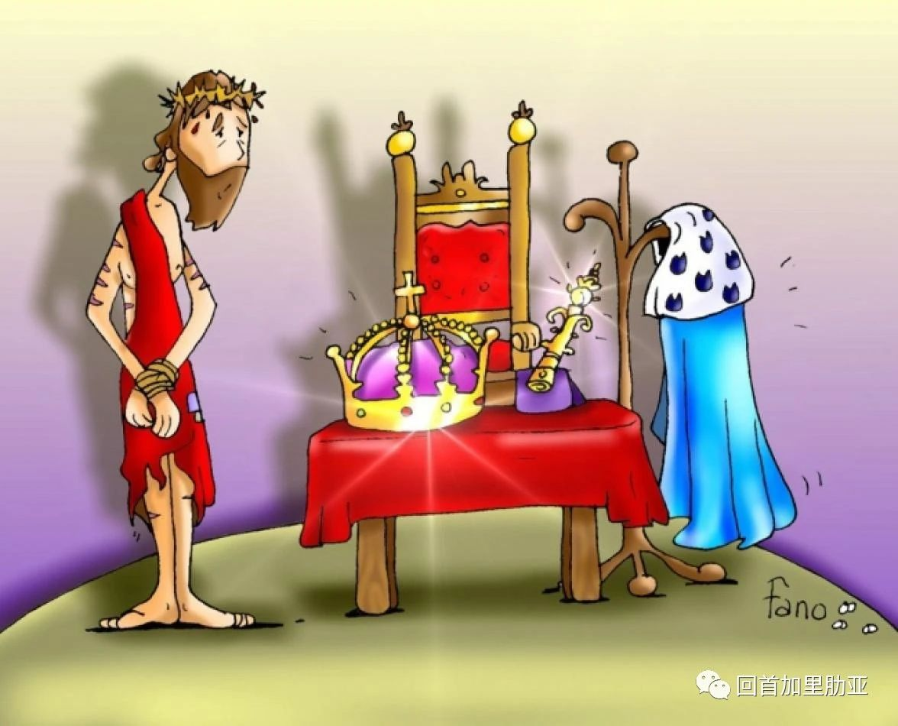

今天读经一里，厄则克耳先知把上主描绘成一个尽心守护我们的牧羊人的样子。为古时候的犹太民族来说，君王首先是牧者，只是，他们从未遇到一个完全把羊群作为自己生命的牧者君王。而天主呢，却俯身成为了这样的一位好牧人，祂不仅看顾自己的羊群，甚至出去寻找走丢的羊只，将他们带回流奶流蜜的牧场。厄则克耳先知笔下的上主，就是这样一位既有仁爱包容又担当审判的君主。祂的仁慈，拓展至迷失的、受伤的群众——既包括因为他人的不正义对待而受苦的人，也包括因为自己的错误选择而走错的人。

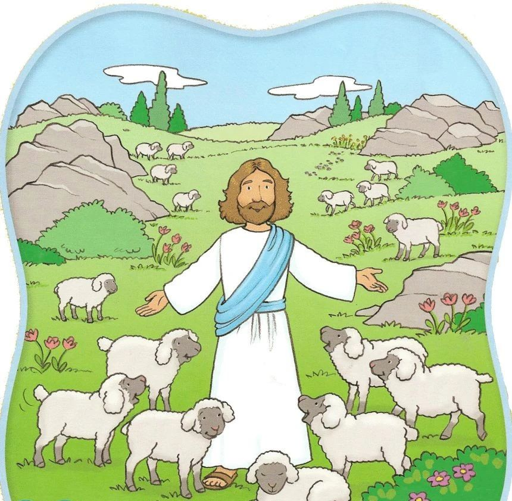

今天的福音，选自玛窦所记载的关于末世的三个比喻中的最后一个，与其说是比喻，不如说是预像。耶稣承接着先知关于牧羊人的比喻，继续用绵羊和山羊来预示将来的审判与分别。身为天主的耶稣，祂好像一个提前泄露了考题的出卷人，告诉我们，在将来那一日，祂的审判只有一个标准：“你爱了吗？”

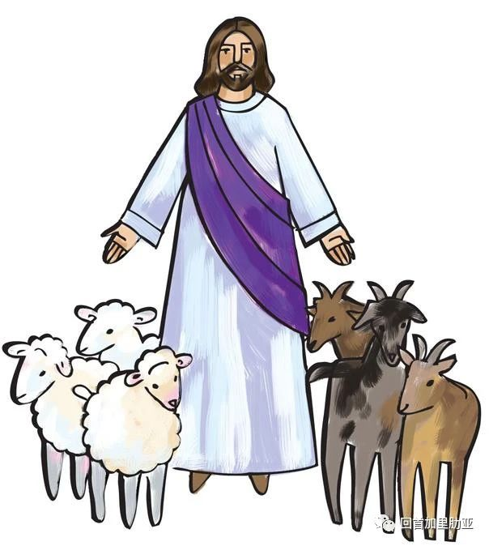

既是天主子也是人子的耶稣，祂把自己委身于最小的弟兄身上，那些“饥饿的”、“口渴的”、“孤独的”、“生病的”、“无衣可穿的”和“坐监牢的”…耶稣在此，揭示了天国的价值：那受苦的人，他们在天主的心中；那为天主去照顾弱小者的人，他们将接受天主的祝福。天主的国度，与世间的不同，我们不会在天国里比谁拥有更多、谁位子更高，天主的国度里，只有一个法律和尺度，那就是爱。伯多禄宗徒写到：最重要的是，你们应该彼此热切相爱；而若望宗徒也说，因为我们彼此相爱，我们得以出死入生(We have passed from death to life because we love one another)。

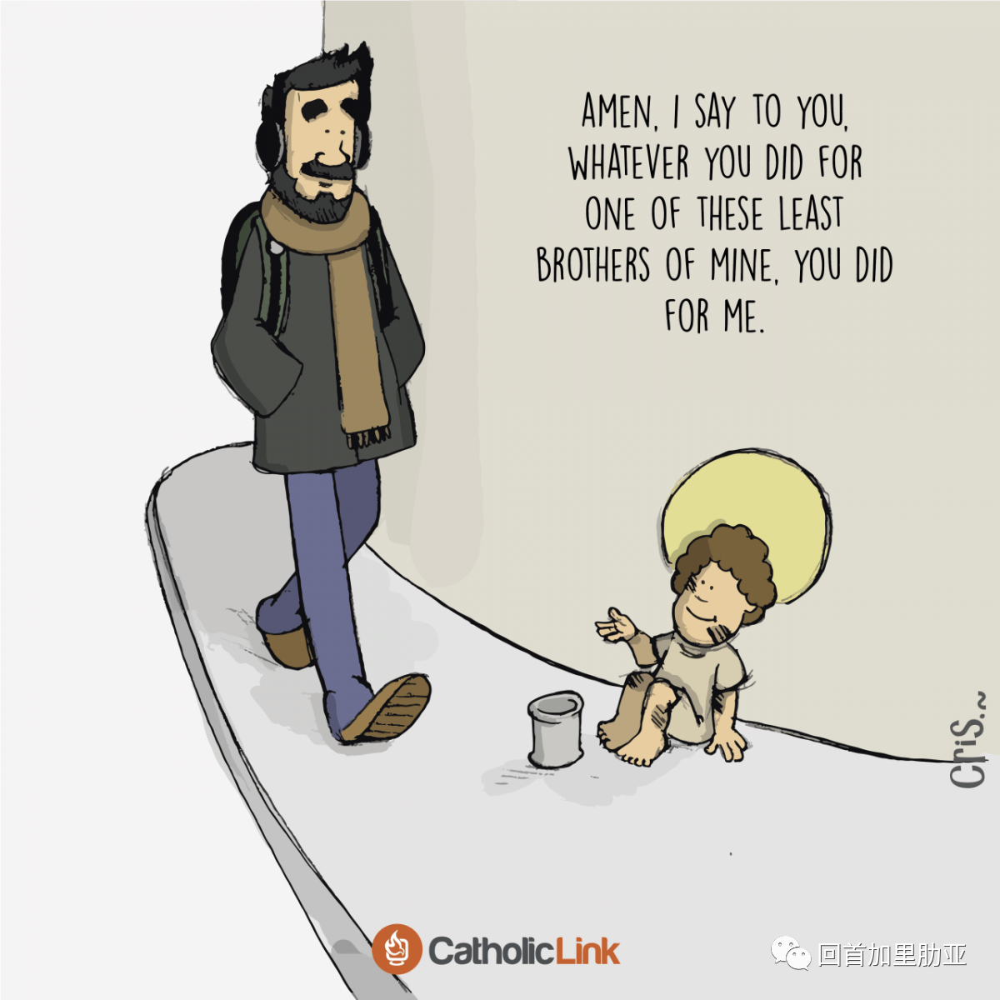

谈及死亡，让我们看看四周，天地万物，这世上的一切，都会过去。正如每一天都有它的夜晚，每一个生命，也都有自己的黄昏，而且这黄昏，总是来得太快。然而，不要失落或绝望，我们持守着的望德，是超越生命的限制的。是的，我们所寻求的那一位，祂在；祂是我们心底无尽的、不灭的渴望，一个永远不会消逝的盼望，一个不会被死亡的阴影所笼罩的信仰；祂也带给我们所有相信祂的人，永恒的光照。

我们相信着，我们盼望着，并因此，我们永远地爱着。过去、现在和未来，所有的一切，总结起来只有一个字，爱。那是怎样的爱？是天主肖像所赋予我们的爱。天主是爱，祂每一刻都在爱；天主圣三的关系，也是爱，爱达致了共融与合一。为我们这些已经知道了期末考试答卷的人，我们要去做的，就是在每一个近人的身上，认出耶稣；就是在跟每一个人的关系中，建立那份爱。我们不只是个体，相似了天主的肖像；我们彼此的关系，更要映照出天主动态的爱。

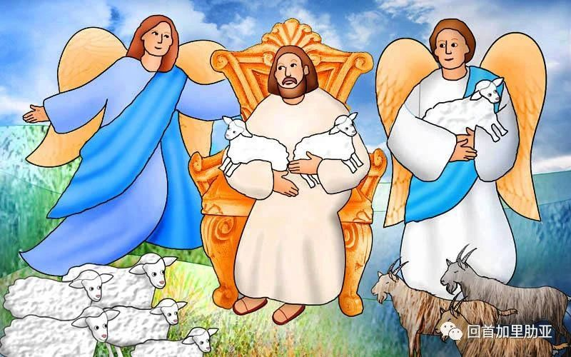

亲爱的孩子们呐，天主的国度，不是未来的，它是从当下、从此刻就已经开始了的；它也不是浮在天上的，它从地上开始，从最小的举动开始——给哭泣的人一个拥抱，给悲伤的人一份陪伴和聆听，给长辈和家人默默地洗碗、没有怨言地服务，给孤独无助的朋友一份带着你惦记和关心的问候，这些爱德的举动，都是天国的种子。

还记得上周塔冷通的比喻吗？宽仁慷慨的天主，为什么在塔冷通上如此严厉，连利息都不肯放过呢？因为天主的馈赠，也是一颗种子，祂热切地期盼着我们通过去爱近人、去服务，来滋养这颗种子，让它发芽长大、让它茁壮有回报。天主馈赠给我们的塔冷通种子，和耶稣今天预许的天主国度，都不只属于我们一个人，都需要我们去浇灌、去付出，来普及所有人，来与大家一同拥有。让我们一起用具体的爱德，来庆祝基督普世君王这个大节日吧！

---

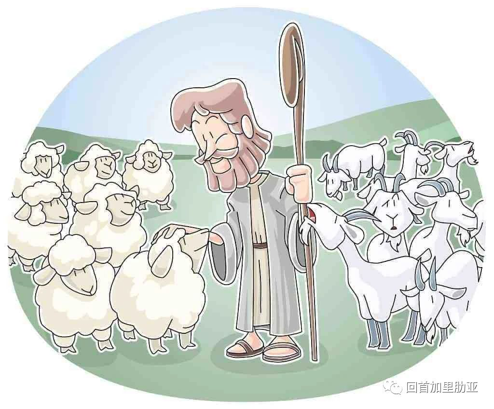

## 给孩子们讲解本周读经

### 给3-7岁的孩子

**烘焙手工：** 今天是个值得庆祝的日子，可以跟孩子们一起做一个皇冠样子的饼干，告诉孩子们，皇冠上的每一粒装饰，都是耶稣爱了我们的时刻；我们去爱近人的举动，也是送给耶稣皇冠的装饰。

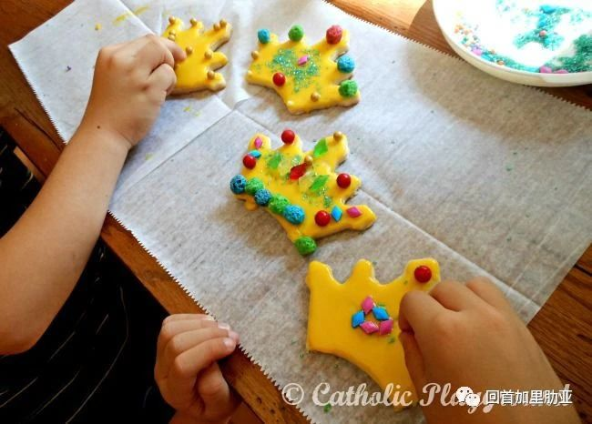

**涂色：** 同孩子们解释，耶稣这个君王，和地上的君王不同。祂是服从、对天主旨意说“我愿意”的君王，十字架是祂爱的标志。

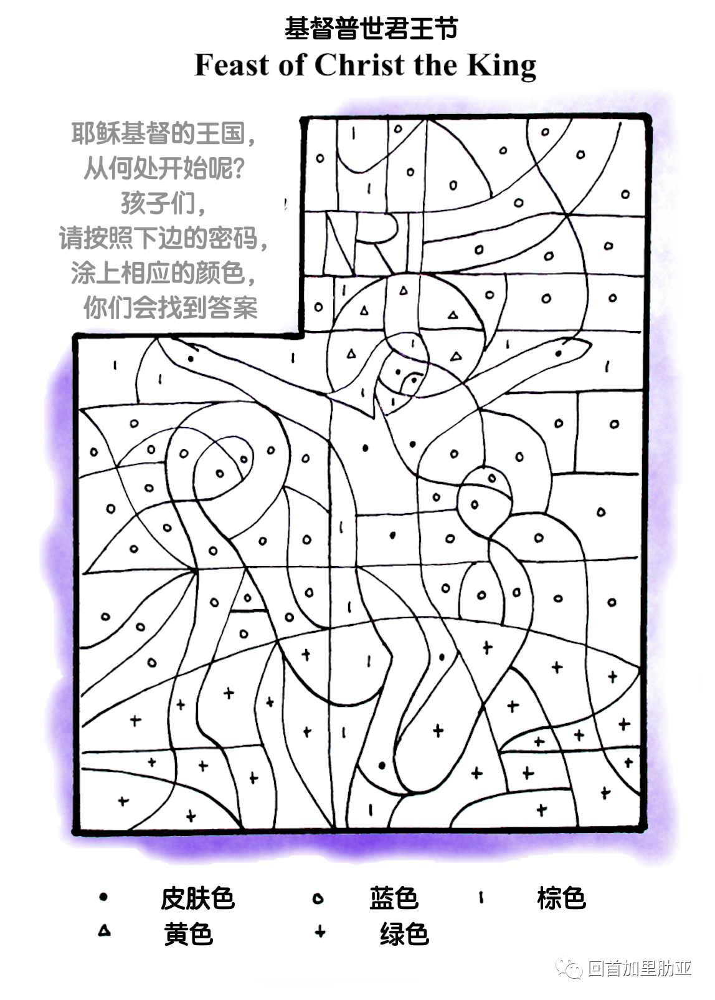

### 给8-12岁的孩子

**手工：** 我们从这个手工游戏开始今天的节日庆祝。在皇冠下边，有五个圆圈，分别表示耶稣基督，是我们每个人的君王，是我们每个家庭的君王，每个团体的君王，每个民族的君王和整个人类全宇宙的君王。这五个圆圈，邀请孩子们画出不同的标志，剪下来贴上去，让我们一起在爱的君王前，朝拜祂无尽的爱。

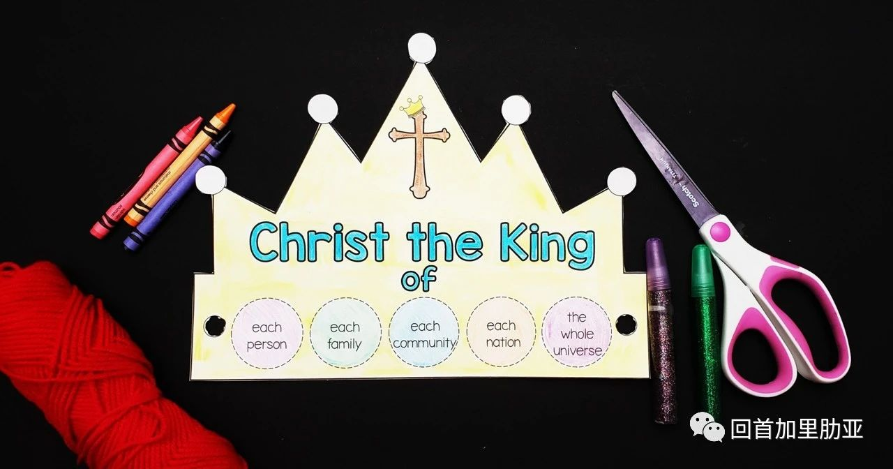

**戏剧和讨论：** 今天的福音画面感很强，可以邀请孩子们分成不同的组，一起来表演出今天的福音。同时，我们也请孩子们一起讨论，我们可以在哪里，遇到耶稣？( _圣体中、近人身上、痛苦的背后、祈祷里……_ )当我们认出耶稣之后，我们可以为耶稣做什么？哪些行为，是我们对耶稣是君王的宣认和朝拜？

**书签摘抄：** 今天福音里，耶稣的这几句话，都可以请孩子们摘抄下来，做成不同的书签，提醒我们：耶稣在最小的兄弟身上，等着我们去爱——“因为我饿了，你们给了我吃的；我渴了，你们给了我喝的；我作客，你们收留了我；我赤身露体，你们给了我穿的；我患病，你们看顾了我；我在监里，你们来探望过我。凡你们给我这些最小兄弟中的一个所做的，就是给我做的。”

### 给青少年

**礼仪：** “基督普世君王节”是一个相对比较新的节日，最初于1925年由教宗庇护十一世确定为正式节庆，一开始的日期是十月的最后一个主日。在梵蒂冈第二次大公会议之后，把这个节庆与礼仪年结合在一起的呼声非常高，因此1969年教宗保禄六世把这个节日改为常年期的最后一个主日，结合了基督耶稣的第二次来临和祂最终战胜了死亡与罪恶的庆祝。梵二的主教们提醒我们，“我们所宣认的信仰与我们的日常生活的分裂，是这个时代最大最严重的错误”，耶稣基督要我们爱天主和爱近人的诫命犹如双胞胎诫命一样，对我们这个时代提出的挑战是，让我们现在的生活变成基督思想所要求的生活，让我们的今天就成为天主国度所要求的样子。

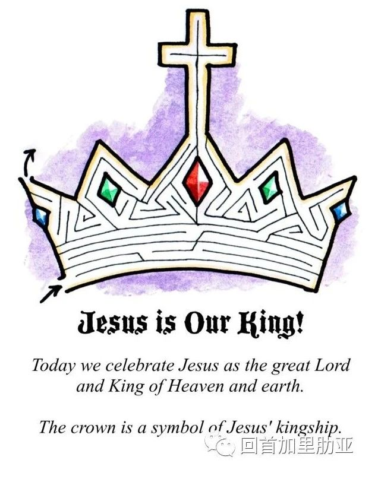

**读经拓展：** 在格林多人前书的第15章里，保禄宗徒提醒了信徒他所传递给他们的有关复活的讯息。保禄指出他们对于死者复活的怀疑，是有悖于基督信仰的，也与他们所经历的生命的力量不相容。今天的读经里，他进一步提出，耶稣基督的复活，是我们所有人复活的基础，也是全人类获得最终救赎的基础。耶稣是死者的初果，这万物丰收的第一份果实，也象征着祂将所收获的万有奉献给天主。

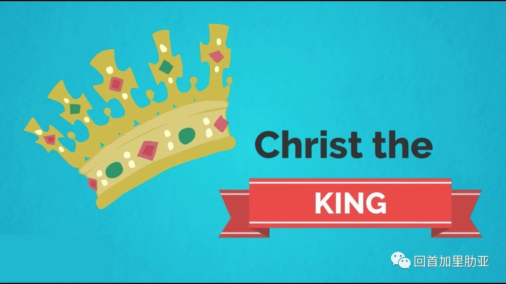
