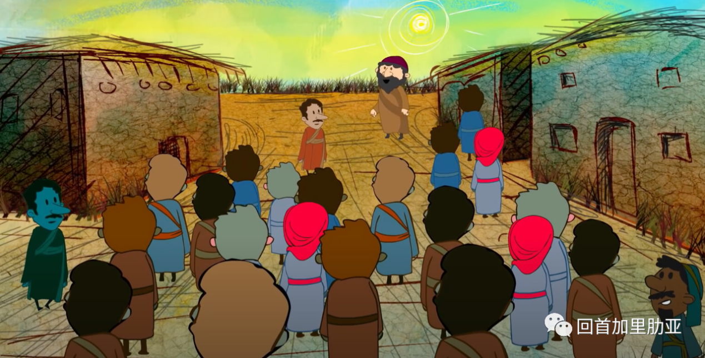
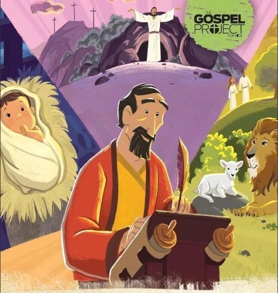
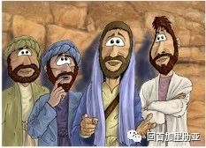
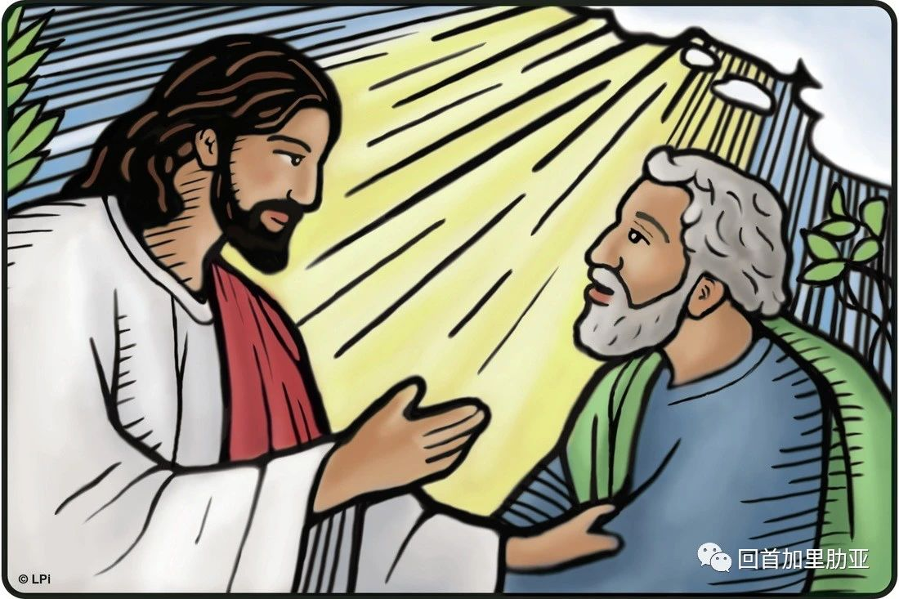
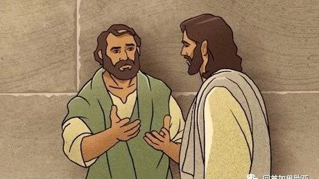
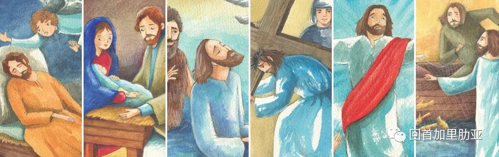
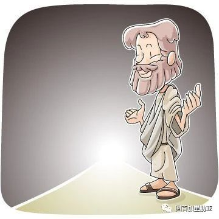
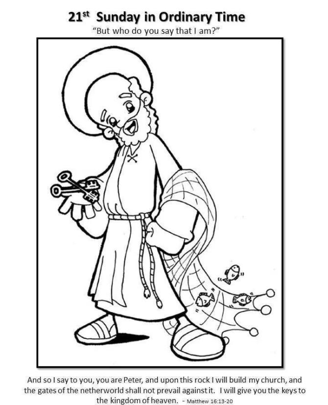
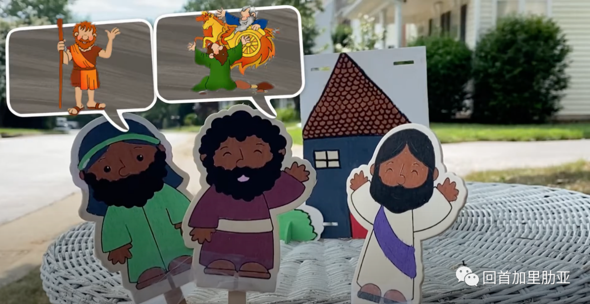
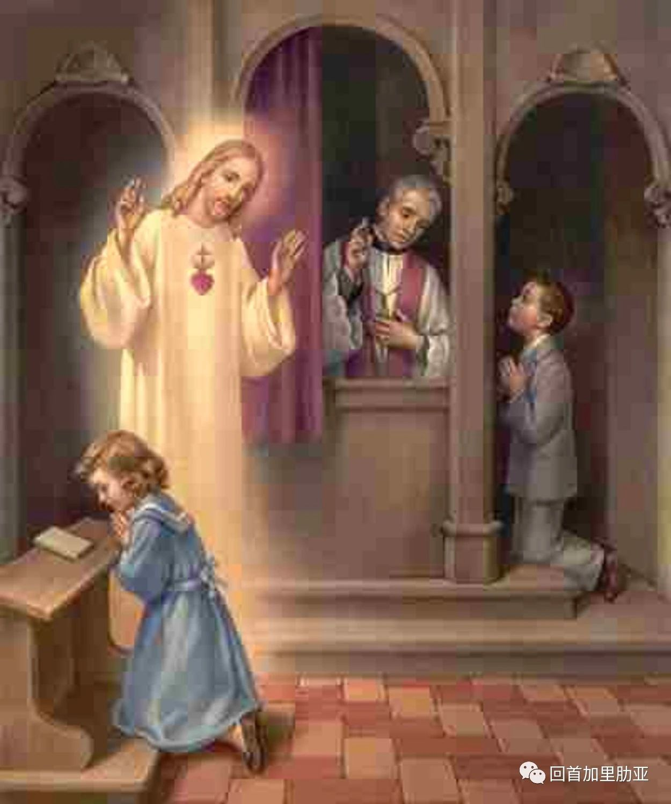

<!--more-->

## 本周读经

**读经一：** 依撒意亚先知书 22:19-23

**答唱咏：** 上主，你的慈爱永世无穷，不要放弃你双手的妙工。

**读经二：** 圣保禄宗徒致罗马人书 11:33-36

**福音：** 玛窦福音 16:13-20

孩子们，主日好。一周未见，你们是不是努力去生活上个主日的福音教导了呢？我们说基督徒的世界观里，没有陌生人，只有尚未结交的好朋友。怀着这样的视角去生活，我们一定可以邂逅生命中的许多美好。

这个主日的弥撒读经，会是怎样的呢？（具体读经内容请看副标题）

这周的读经一，还是来自依撒意亚先知。「依撒意亚」这个名字的意思是，“天主是救援”。的确，他作为先知的一生，都在苦口婆心地劝勉百姓和列王们，离开罪恶，归向上主，因为天主是唯一的救援，只有依靠上主才可以获得平安。然而，他坎坷的人生故事，却是一边奔走疾呼、一边不得不见证掌权者的执迷不悟，导致国家和民众的沦陷，最后依撒意亚先知自己，也死于昏君之手。

但是，孩子们，千万不要以为依撒意亚先知的故事，只有历史的沉重和无奈。事实上，虽然依撒意亚先知比耶稣的年代早了八百多年，他却被认为是旧约的四大先知中，对新约教会影响最深刻的一位。为什么呢？因为先知书的后半部分，既明确又充满光照地预言了救主默西亚的到来，这位救主将带给整个民族、整个人类真正的救援和安慰。这也是为什么，如果你们去看大师们画笔下的依撒意亚先知，经常会穿越般，见到他和我们的婴孩耶稣同框。

今天的读经一里，依撒意亚先知提到了吾主上主要把达味家的钥匙放在一个人的肩上，由他来掌管开和关。与旧约的先知书相映成趣的是，八百年后的福音里，依撒意亚先知所预言的救世主耶稣，今天，也要来托付一把钥匙，是什么钥匙？托付给谁呢？

> 原文此处有一段故事视频，来自天主教 Christian Heroes 平台。

孩子们，你们喜欢这段故事吗？我们已经陆陆续续讲了不少耶稣和伯多禄之间的趣事，那一眼万年、一诺千金的相逢，那莽莽撞撞又赤诚忠心的追随，那亦师亦友、肝胆相照的情谊……作为门徒之首的伯多禄，很大程度上，也代表了我们。

伯多禄和他领衔的宗徒们，爱耶稣，喜欢听祂讲道，愿意放下一切追随祂，以师傅为荣，也经常要面对师傅给他们的灵魂拷问。今天，师傅问他们——

> 「你们说，我是谁？」
> 
> *玛窦福音 16:15*

众人瞠目结舌之后，伯多禄站了出来。对，就是那个可爱的、鲁莽的、总是冲在最前面的伯多禄。他说什么呢？他说：“你是默西亚，永生天主子。”哗！这位仁兄，可是两周前在摇摇晃晃的船舷边，高声对步行海面的耶稣，用试水般的语气说：“倘若你是主……”的那位。今天，他的回答，仿佛开了挂一般。

那一刻，耶稣也明白了，祂明白，自己的时刻到了。因为三年来的宣讲、医治、陪伴、祈祷…天主已经准备好了祂的门徒们。“不是肉和血启示了你，而是我在天之父”。

对于我们来说，也是一样的。当我们充满光照、从心底对耶稣说出：“你是我的天主，你是我生命的全部”那一刻，我们也宣认了我们的信仰，成为了耶稣的门徒。

> 耶稣跟伯多禄说：“我要将天国的钥匙交给你。”所以，今天，我们看到世界各地的圣伯多禄雕像、画作里，我们的伯多禄，都拿着一把（天国的）钥匙。

可是，拿着天国的钥匙，是说伯多禄就成了普世教会的 CEO 吗？不不不，孩子们，在耶稣的国度里，领导者的职能，是爱与服务。耶稣托付的这把钥匙，象征着伯多禄和世世代代伯多禄的继承者们，都要成为合一的关键，成为普世教会合一的关键；而教会，要成为人类与天主合一的地方。

说到委以重任，伯多禄并不是门徒中最出色的一位，其实，一众的门徒们，也都不是当时世人眼中最卓越的一群。然而，耶稣，并没有因为伯多禄有很多人性的缺点而犹豫。相反，耶稣告诉伯多禄，祂要在伯多禄这块磐石上，建立起祂的教会。会是怎样的教会呢？是由普通人组成的教会，普普通通的我们，像伯多禄一样，有很多的软弱和缺点。我们这些普通人的人生，并不是布满高光时刻，我们总有难以逾越的困境，总有大大小小的痛苦，但我们也是用这平凡的人生，向天主的旨意开放。我们也一遍又一遍地向耶稣宣认：“你是默西亚，你是我的主。我愿意为祢改变、愿意投奔于祢、愿意走祢的道路。”

我们如此向天主敞开，把自己交托给祂。一如两千多年前，耶稣亲自来治愈门徒和改变门徒一样，今天，祂也要来，祂既接纳我们的软弱和不足，祂也相信我们可以改变，相信我们可以在交托中，与祂达致合一，好能实现天国。

*“我是道路、真理、生命。”（若 14:6）*

今天的福音里，耶稣问了，“你们说我是谁？”我想，耶稣其实，还留了一个问题，在以后的福音中，祂会告诉我们。这个问题就是：谁是耶稣？

我们需要来自天主的启示，才能宣认耶稣是谁。同样地，我们也需要在爱内，认出谁是耶稣——祂在圣体圣事内，在每一个人近人身上，在最弱小、最需要帮助的弟兄身上，在每一个痛苦和呻吟的背后。让我们，认出耶稣，拥抱耶稣。爱和服务，是我们跟随耶稣的方式。只有去爱我们生命中遇到的每一个“耶稣”，我们才是真正地宣认了，耶稣，是我们生命的主。

✦ ✦ ✦

## 给孩子们讲解本周读经

按年龄分组的讨论、游戏与活动建议

### 3–7 岁

从“谁是带头人”开始，认识耶稣与伯多禄的对话。

**讨论：** 耶稣问门徒们，人们说我是谁，门徒们怎么回答呢？（你知道这些人物都是谁吗？老师们可以根据孩子们的年龄，来告诉他们先知的意思，或者先知的故事。）问问孩子们，谁是我们教会的带头人呢？（教宗，主教、神父）

**游戏 · 谁是带头人：** 可以跟孩子们一起做“谁是带头人”的游戏。就是请一个人先出去，剩下的一群人，选一位作为带头人，带头做动作和变换动作，其余人都要跟上；之后请刚才出去的小朋友回来，在动作变换的过程中，猜哪一个人是“带头人”。用这个游戏，来告诉孩子们，带头人的作用。

**涂色：** 可以让小小孩们一边涂色，一边重复耶稣跟门徒们的对话，尤其是耶稣对伯多禄的委任。

*涂色页：圣伯多禄手持天国的钥匙与渔网，常年期第二十一主日，玛窦福音 16:13-20*

### 8–12 岁

从两把“钥匙”出发，理解管家与慈父的角色。

**讨论 · 两把钥匙：** 读经一中，天主给了国王的新管家一样东西，你们还记得是什么吗？（钥匙。）福音里，耶稣也给了伯多禄钥匙。你们怎么理解钥匙？（就好像先知书里记载的，天主把管治权，交在他手中。他将作家族的慈父。伯多禄和伯多禄的继承者，教宗们，也拥有对天主教会的管治权。）

**讨论 · 为什么要有管家？** 为什么耶稣希望教会有一个管家／慈父？（耶稣希望祂所建立的教会，行走在祂所教导的路径上。耶稣不愿意我们好像迷路的羊，所以给了我们教宗和所有的神职人员，牧放祂的羊群）

**戏剧表演：** 邀请跟孩子们一起下载并剪出如下图的人物标签，表演今天门徒与耶稣的对话，来加深他们对福音的记忆。主日学的老师或者爸爸妈妈们，也可以跟孩子们一起查查，民众说的耶肋米亚先知是谁。

*人物纸偶：用对话重演“人们说我是谁？”*

### 青少年

深入“人子”与“天主子”，以及束缚与释放的权柄。

**讨论 · 人子与天主子** 耶稣自称为“人子”，祂也被称为“天主子”。为什么“子”这个属性很重要？（表明耶稣既是完完全全的人，也是完完全全的天主。达尼尔先知书 7:13-14 就记载了这样的神视，“一位相似人子者”，要来接受永远的王权，他的国度永不灭亡。）

读经二里，博学又充满智慧和洞见的圣保禄，终于到了他的理解力极限。他写下了诗歌一样的感叹，来赞美天主的高深和不可测量。今天的读经二和答唱咏都非常美，可以像诗歌一样朗诵。

**礼仪 · 赦罪的权柄** 耶稣给伯多禄“束缚和释放”的权柄，也被理解为是赦罪的权柄。赦罪权来自哪里？（来自耶稣。管家只能行使主人授予的权柄。这也提醒了我们告解圣事中，神父们以基督的名义，赦免我们的罪过。）

*告解圣事：神父以基督的名义赦免罪过*

---

**资料来源：**
视频来自天主教 Christian Heroes 平台
图片资料来自 Loyola Press、Christian Clip Arts 等

原文：Ideale d'Amore · 回首加里肋亚 · 2020-08-23

**原创不易，请订阅我们**

**👉并分享给更多你爱的人们**

*   [儿童主日学](https://urlove.wixsite.com/inme/首頁/categories/儿童主日学)